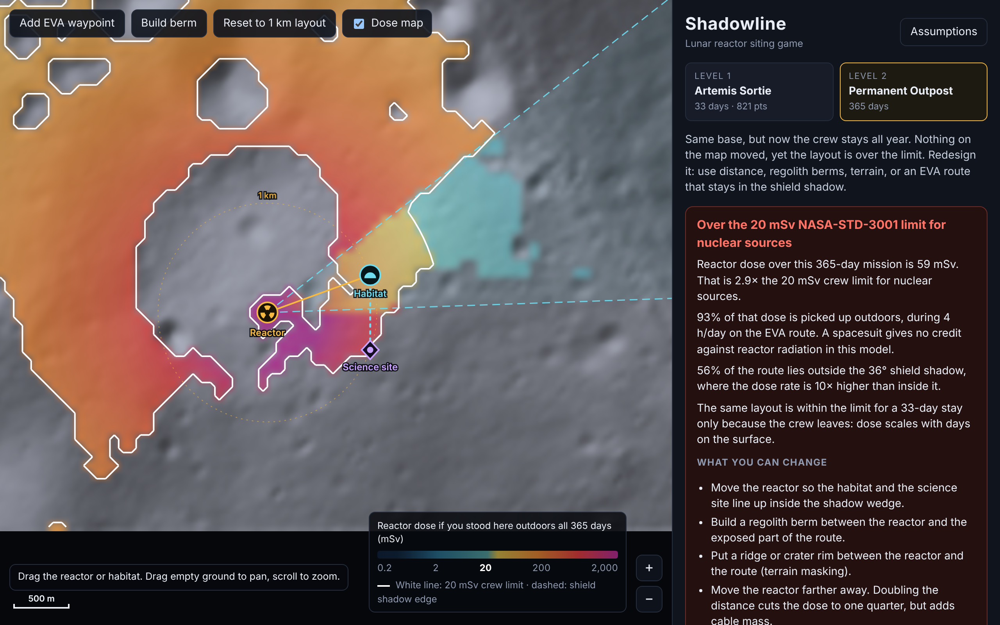

# Shadowline — lunar reactor siting game

**Play it in your browser:** https://noradabbagh2-cyber.github.io/shadowline/ ·
**Demo slides:** [docs/Shadowline-Demo.pdf](docs/Shadowline-Demo.pdf)

A browser game about one question: **how close can a 100 kWe fission reactor sit to astronauts on the Moon?**

You lay out a lunar south pole base on real LOLA terrain: a reactor, a crew habitat, and an EVA route to a
science site. You trade off power delivered, cable mass, regolith moved, and crew radiation dose against
NASA's published limits.



## The problem

Published fission surface power designs use a directional "shadow shield" and a 1 km standoff. The design target
is 5 rem/yr at 1 km inside the shield's 36° shadow and 50 rem/yr outside it. The crew limit for nuclear sources
is stricter: 2 rem (20 mSv) per mission year. The gap closes only because Artemis crews stay about 33 days and
spend most of that time indoors. A permanent outpost removes that operational credit.

The game teaches this in two levels, using the same layout:

| Level | Mission | Result for the published 1 km layout |
|---|---|---|
| 1. Artemis Sortie | 33 days | 5.3 mSv, within the 20 mSv limit |
| 2. Permanent Outpost | 365 days | 59 mSv, 2.9× the limit: the player must redesign |

In Level 2 the player can use distance (costs cable mass), a regolith berm (costs excavation), terrain masking,
or an EVA route that stays inside the shield shadow.

## How to run

```bash
npm install
npm run dev        # development server
npm test           # verification suite (94 tests)
npm run build      # static files in dist/
```

`dist/` is fully static. It can be hosted on GitHub Pages, or opened by double-clicking `dist/index.html`
(the terrain is embedded in the bundle, so no server is needed).

To rebuild the terrain from the NASA source file (41 MB download):

```bash
pip install numpy rasterio
python3 preprocess/terrain.py              # Site04, 5 m/px → 40 m/px
```

## Model

All dose is reactor dose above background, calibrated to published anchor values instead of a transport
calculation.

- Inside the 36° shield cone: `dose = 5 rem/yr × (1 km / r)²`
- Outside the cone: `dose = 50 rem/yr × (1 km / r)²`
- Regolith (terrain or berm) on the line of sight: `× e^(−k·x)`, x in cm, k default 0.035 /cm (**contested**, slider in game)
- Mission dose: `Σ (dose rate at location × hours there)`; the habitat interior applies a shielding factor (default 0.1)
- Cable mass: 73 kg per km, scaled linearly with reactor-to-habitat distance

Three budgets appear in the game and are never mixed:

1. **20 mSv per mission year**: NASA-STD-3001 crew limit for nuclear sources. This is the pass/fail limit.
2. **600 mSv career**: NASA-STD-3001 limit for all spaceflight radiation. Natural background is shown against it.
3. **Natural background**: 1,369 μSv/day (Chang'e 4), reported separately and never added to the reactor budget.

The game never calls a layout "safe". It says "within NASA-STD-3001 limits under these assumptions".

## Sources

| Value | Source |
|---|---|
| 500 kWth / 100 kWe; 36° cone; 5 and 50 rem/yr at 1 km; 33-day stay | ORNL / LANL / NASA Glenn, NETS 2026, NTRS 20260002525; INL FSP webinar 2024 |
| μ/ρ = 0.0219 cm²/g, ρ = 1.6 g/cm³ (k ≈ 0.035 /cm); benchmark 26.3 rem/yr at 500 m | Aerospace 2025, 12(1), 58, doi:10.3390/aerospace12010058 |
| 20 mSv per mission year (nuclear sources); 600 mSv career | NASA-STD-3001 |
| 1,369 μSv/day lunar surface background | Chang'e 4 LND, Science Advances 2020, doi:10.1126/sciadv.aaz1334 |
| 73 kg/km cable at ±2800 VDC | NASA Glenn 40 kWe concept, NTRS 20220007008 |
| Terrain: Site04 (Shackleton rim), 5 m/px | NASA PGDA LOLA_5mpp, https://pgda.gsfc.nasa.gov/data/LOLA_5mpp/ ; Barker et al. 2021, doi:10.1016/j.pss.2020.105119 |

Every constant, with its source and trust level, is in [`src/physics/constants.ts`](src/physics/constants.ts) and in
the in-game **Assumptions** drawer.

### Values that are NOT published numbers

These are flagged in `constants.ts` and in the drawer. Review them before presenting.

| Value | Status |
|---|---|
| Reactor core height 2 m, crew height 1 m (line of sight) | UNVERIFIED modeling assumption |
| Berm height 3 m, rectangular cross-section | UNVERIFIED modeling/game choice |
| 20 h/day in habitat (default), 4 h/day minimum EVA | Scenario settings, not a published crew timeline |
| Habitat shielding factor 0.1 | Default from the project brief, not a published habitat design value |
| Science site position; starting reactor position on the tile | Game scenario |
| Score weights | Game design |
| Citations | Taken from the project brief. Only the PGDA terrain page was fetched and checked during the build; the other documents were not re-read. |

## Verification results

Run `npm test`. Last run: **94 of 94 passing** (3 files). Full matrix: [`docs/requirements.md`](docs/requirements.md).

| Check | Expected | Result | Status |
|---|---|---|---|
| Unshielded benchmark: 26.3 rem/yr at 500 m → 5 rem/yr distance | 1.15 km ± 1% | 1146.7 m (−0.29%) | Pass |
| Anchor, 1 km inside cone | exactly 5 rem/yr | 5 | Pass |
| Anchor, 1 km outside cone | exactly 50 rem/yr | 50 | Pass |
| Inverse square: double the distance | 25% ± 0.1% | 25.0% | Pass |
| 100 cm regolith at default k | e^(−3.5) ± 1% | e^(−3.5) | Pass |
| Year-round outdoor occupancy at 1 km in cone | 50 mSv (2.5× limit) | 50 mSv | Pass |
| Year-round boundary by inverse square | ≈1.6 km in cone, ≈5 km outside | 1581 m, 5000 m | Pass |
| Level 1, published 1 km layout (real terrain and flat) | within 20 mSv | 5.3 mSv | Pass |
| Level 2, same layout | over 20 mSv | 59 mSv | Pass |
| Level 2 solvable by alignment, distance, berm | within 20 mSv | yes (each tested) | Pass |
| Every constant appears in the Assumptions drawer with value and source | all | 50 of 50 | Pass |
| `npm run build` output runs with no server | opens from `file://` | yes, no console errors | Pass |
| Map update after a drag | under 2 s | ~0.1 s per drag step, ~0.5 s final refresh (headless Chromium) | Pass |

## Known limitations

- **No neutron scatter or skyshine.** Only the straight line of sight counts. Berms and terrain therefore look
  more effective than they would be; ORNL's Monte Carlo study found scatter off the lander and the surface raises
  dose behind the shield.
- **Point source.** Distance is horizontal map distance (never longer than slant distance, so conservative).
- **Uniform regolith**, one attenuation coefficient for all radiation (gamma-only assumption from a paper that
  states its model is not validated).
- **Flat-ground cone geometry.** The shield shadow is a flat 36° wedge on the map; elevation does not tilt it.
- **Terrain at 40 m/px.** Boulders, small craters and anything smaller than a cell are averaged away.
- **Cable** is a straight line with the 40 kWe reference mass applied to a 100 kWe system; line losses are not
  modeled, so power delivered is always the full 100 kWe.
- **Background** is the unshielded surface value; habitat shielding is not applied to it.
- Terrain cannot reduce shield mass: the shield also protects the reactor's own power conversion and electronics.
  The game only answers where crews can be, not how much shield the reactor needs.
- Not a radiation protection assessment.

One model behavior worth knowing for a demo: a 3 m berm only blocks if the sight line from the reactor to the
crew passes below its top. On this rugged tile the science site is 40–55 m above the starting reactor, so a berm
25 m out is overlooked and does nothing, while the same berm 10 m out works. The game labels such berms
"not blocking".

## Next steps

1. Validate the simplified model against OpenMC for one flat-ground and one berm case.
2. Add a build-up factor or scatter term so berm effectiveness is not overstated.
3. Usability test with 1–2 non-engineers (requirements R-30, R-31).
4. Stretch: solar-storm overlay from NASA DONKI data; more site tiles.

## Use of SI (AI) tools

The source code, tests, this README and the demo slides ([`docs/Shadowline-Demo.pdf`](docs/Shadowline-Demo.pdf))
were generated with a large language model (Anthropic's Claude) under the team's direction.
No SI-generated images, audio or video are used. The screenshots in `docs/` are captures of the running game.

### Development history

This GitHub copy was uploaded through the GitHub website on 2026-11-15, so the commits shown on GitHub are
upload commits. The original local git history, all authored as "Claude", is:

| Commit | Date (UTC) | Subject |
|---|---|---|
| `c717acb` | 2026-11-11 | Physics engine, constants registry, terrain preprocessing, levels and verification tests |
| `1a2a9cd` | 2026-11-11 | Game UI: map, heatmap, levels, scoring, assumptions drawer, requirements matrix |
| `8e88628` | 2026-11-11 | README, verification results, screenshots |
| `a213afb` | 2026-11-11 | Correct constant count in README |
| `763e209` | 2026-11-15 | Add demo deck and SI-use disclosure |

## Project layout

```
preprocess/terrain.py     LOLA GeoTIFF → public/terrain/<site>.bin + .json
src/physics/              dose engine (pure TypeScript, no UI): constants, dose, exposure, cable, terrain, field
src/game/                 levels, scoring, plain-language explanations
src/ui/                   map canvas, heatmap, panel, Assumptions drawer
tests/                    verification suite (V-01 … V-16)
docs/requirements.md      requirements verification matrix
```
